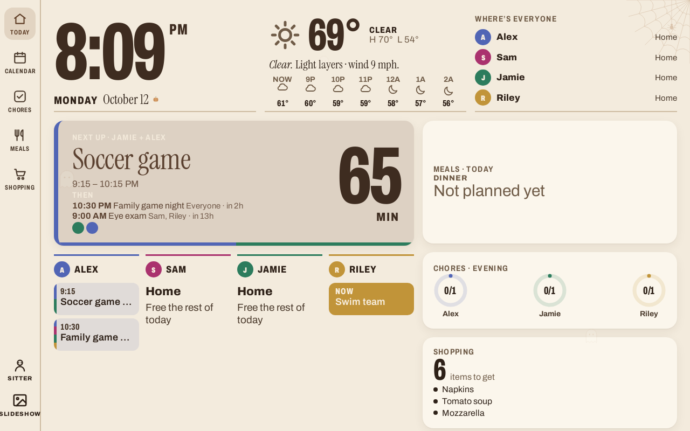
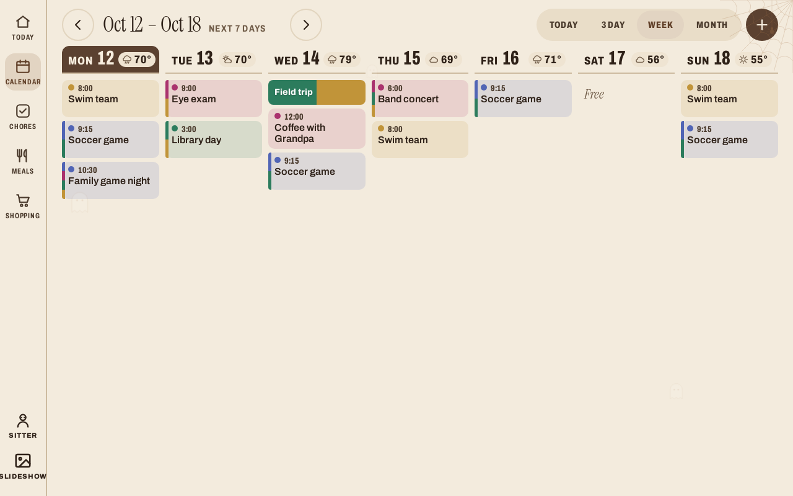
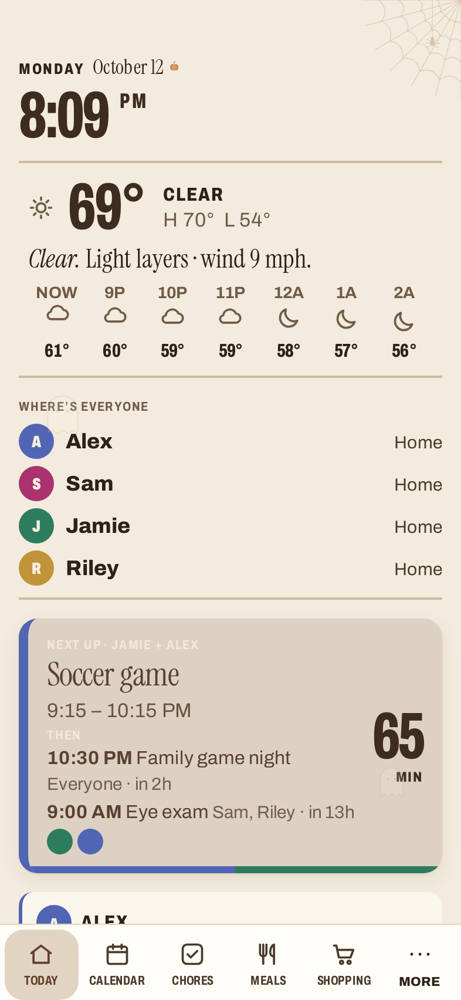

# Home HQ — a family wall dashboard

> Built on the original [photo-frame-dashboard](https://github.com/wesbos/photo-frame-dashboard) idea by [Wes Bos](https://github.com/wesbos), with practical family updates — here's my version.
>
> Built with **Grok Bot**.

Home HQ turns a cheap Android photo frame, an old tablet or any browser into a calm kitchen dashboard
for the whole family: today at a glance, a shared calendar, chores with stars, meals and the
shopping list. Everything runs on **your own free Cloudflare account**. No subscription, no tracking.

[](https://deploy.workers.cloudflare.com/?url=https://github.com/dario-d-c/home-hq)

| Today | Week | Phone |
| --- | --- | --- |
|  |  |  |

<!-- SCREENSHOT PLACEHOLDER: add a photo of your frame on the wall here, e.g. docs/screenshots/frame-on-wall.jpg -->

## Features
- **Today:** clock, weather, where everyone is, what's next, dinner, chores and shopping at a glance.
- **Calendar:** day / 3-day / week / month views. Each person has a colour. An event shared by several
  people shows **once**, striped in everyone's colours. Drag and resize events (signed-in parents).
- **Calendar sync:** paste Google, iCloud, Outlook or school `.ics` / `webcal://` links. They sync
  every 15 minutes, and a calendar can belong to several people.
- **Chores:** morning / after school / evening routines, stars, and a week view.
- **Meals:** dinner plan plus school breakfast and lunch menus. Import a menu from a photo or PDF with Workers AI.
- **Shopping:** a list per store, your usual items, and shopping trips.
- **Routines & days off:** weekly schedules, plus vacation/day-off banners.
- **Babysitter page:** a shareable, revocable link with the care schedule.
- **iPhone widget** (Scriptable): small, medium, large and Lock Screen sizes.
- **Themes and seasons:** several looks, seasonal touches, night mode and a photo screensaver.
- **Works everywhere:** wall frame (kiosk app in `kiosk/`), iPad, phone. Real phone layout, landscape and portrait.

## Deploy (about 5 minutes)
1. Click **Deploy to Cloudflare** above. Sign in to (or create) a free Cloudflare account.
   Cloudflare copies this repo to your GitHub, creates the **KV** storage and the **Workers AI**
   binding, builds and deploys. Nothing to configure by hand.
2. When it asks for secrets, fill in:
   - `EDIT_PASSCODE`: a family passcode for editing (any phrase).
   - `FRAME_KEY`: a long random string for the wall screen (`openssl rand -hex 24`, or mash the keyboard for 40+ characters).
3. Open `https://<your-worker>.<your-subdomain>.workers.dev/`, sign in with the passcode and follow
   **"Let's set up your family"**: add people, then stores, chores and calendar links.
4. On the wall frame or tablet, open `https://<your-worker>…/?key=<FRAME_KEY>` once. It remembers the key.

You can change secrets later in **Cloudflare dashboard → Workers & Pages → your worker → Settings → Variables and Secrets**.

### Login: passcode (default) or Cloudflare Access (optional, nicer)
- **Passcode mode** is used automatically when Access isn't configured. `/auth` shows a passcode
  form and keeps you signed in on that device for a year.
- **Cloudflare Access** gives each parent an email one-time-code login:
  1. Cloudflare dashboard → **Zero Trust** (free plan is fine) → note your team domain, e.g. `https://myfamily.cloudflareaccess.com`.
  2. **Access → Applications → Add → Self-hosted**. Domain: your worker's hostname, path `auth`.
     Policy: *Allow* → *Emails* → your family's addresses. Login method: One-time PIN.
  3. Copy the application's **Audience (AUD) tag**.
  4. In the worker's **Variables**, set `ACCESS_TEAM_DOMAIN` and `ACCESS_AUD`, then redeploy.
  The passcode still works as a fallback in the editor.

### Deploy from your computer instead
```bash
npm install
npx wrangler login
npx wrangler secret put EDIT_PASSCODE
npx wrangler secret put FRAME_KEY
npm run deploy        # first deploy creates the KV namespace automatically
```

## Run locally
```bash
npm install
cp .dev.vars.example .dev.vars    # set a passcode and frame key
npm run dev:worker                # http://localhost:8787 (local KV, empty data)
```
Photo/PDF import needs Workers AI, so it only works when deployed.
Data starts empty: no sample family is shipped.

## Hardware suggestions
Any screen with a modern browser works. Some ideas:
- **10" Android photo frame** (what the original project hacked). See Wes Bos's
  [frame guides](https://github.com/wesbos/photo-frame-dashboard#readme): [shop on Amazon](https://www.amazon.com/s?k=10+inch+touchscreen+digital+photo+frame&tag=dario0b1-20)
- **Amazon Fire HD 10** with a kiosk browser: [shop on Amazon](https://www.amazon.com/s?k=fire+hd+10+tablet&tag=dario0b1-20)
- **Older iPad** in Guided Access, on a wall mount: [shop on Amazon](https://www.amazon.com/s?k=ipad+picture+frame+wall+mount&tag=dario0b1-20)
- **Slim USB-C power cable / in-wall power kit:** [shop on Amazon](https://www.amazon.com/s?k=in+wall+power+cable+kit+tablet&tag=dario0b1-20)
- **Adhesive or screw wall mount:** [shop on Amazon](https://www.amazon.com/s?k=tablet+wall+mount+adhesive&tag=dario0b1-20)

_As an Amazon Associate I earn from qualifying purchases._

<sub>Some links may be affiliate links; buying through them supports the project at no extra cost to you.</sub>

The `kiosk/` folder has a tiny full-screen WebView Android app (from the original project). Set
`DEFAULT_URL` in `kiosk/src/.../MainActivity.java` to your worker URL, and build with `kiosk/build.sh`.

## iPhone widget (Scriptable)
1. Install [Scriptable](https://apps.apple.com/app/scriptable/id1405459188) (free) and open it once.
2. In Home HQ: **Edit → More → iPhone widget**, then follow the steps there to create a token and copy the script.
3. In Scriptable, tap **+**, paste, and name it **Home HQ**. Tap ▶︎ to preview.
4. Long-press the home screen → **Edit → Add Widget → Scriptable**, pick a size, then long-press the
   widget → **Edit Widget** → Script: *Home HQ*.
The token is read-only and can be revoked from the same screen.

## Configuration notes
- Weather location: **Edit → More → Look & layout** (default is New York, NY).
- The home time zone is currently `America/New_York` in a few places (`worker/widget.js`,
  `worker/index.js` weather, `js/remote.js`). Search for `America/New_York` to change it.
- All data lives in your own KV namespace (key `data`, plus calendars/photos keys). Back it up with
  `npx wrangler kv key get data --binding DATA_KV --remote > backup.json`.

## Provided as-is
This is a personal project shared in case it helps your family. It's provided **as-is, with no
support or warranty**. Issues and PRs are welcome, but replies aren't guaranteed.

## Support / donate
If Home HQ makes your mornings calmer, you can say thanks:
- GitHub Sponsors: https://github.com/sponsors/dario-d-c
- Buy Me a Coffee: https://buymeacoffee.com/Dario_d_c

## License and credits
MIT for this project's changes. See [LICENSE](LICENSE) and [NOTICE.md](NOTICE.md). The original
photo-frame-dashboard is by Wes Bos and contributors. Please read the note in NOTICE.md about its
license status. Built with Grok Bot.
